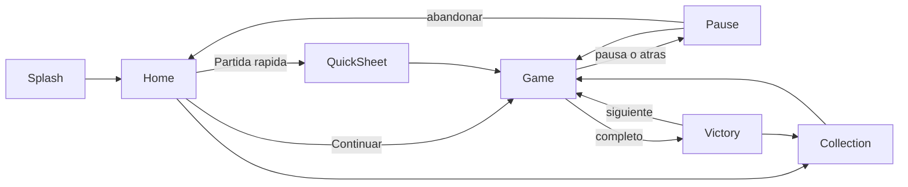
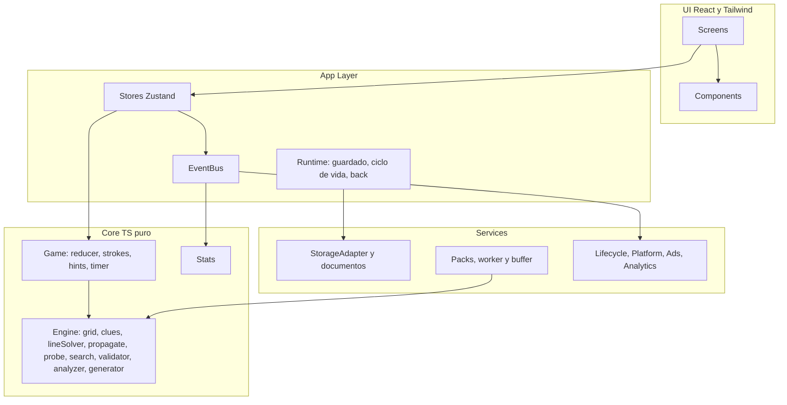

# Plan funcional y técnico: Nonogram para Android

**Nombre:** Nonogram.

Proyecto nuevo en `W:\repos\personal\nonogram`. Arranca con una copia de la infraestructura ya probada del Sudoku (`W:\repos\personal\sudoku`) y se extrae a un monorepo en la Fase 5.

## 1. Concepto del juego

**Qué es:** un nonograma clásico en blanco y negro. Cada puzzle es una imagen pixelada oculta que se descubre deduciendo con las pistas numéricas de filas y columnas. Las partidas son cortas (de 2 a 15 minutos), la experiencia es relajada y no hay vidas.

**Experiencia principal:** "deducir, pintar y descubrir el dibujo". La recompensa es la imagen revelada con su nombre al terminar.

**Flujo completo:**

1. **Abrir la app.** Aparece el splash y se carga el estado guardado. Si hay una partida en curso, Home muestra la tarjeta "Continuar".
2. **Elegir un puzzle**, por una de dos vías:
   - **Colección:** puzzles con dibujo, agrupados por tamaño.
   - **Partida rápida:** un patrón abstracto generado al momento, eligiendo tamaño y dificultad.
3. **Resolver.** El timer arranca cuando se muestra el tablero. El jugador pinta con la herramienta "Rellenar" y tacha con "Marcar".
4. **Corregir.** Puede deshacer, borrar repasando con la misma herramienta y pedir pistas.
5. **Completar.** Cuando las celdas llenas coinciden con la solución, se termina sola: se detiene el timer, aparece la animación de revelado y la pantalla de Victoria con tiempo, errores, pistas y récord.

**Casos especiales:**

- **Salir al Home o a la Colección:** la partida se pausa y su progreso queda guardado por puzzle. No cuenta como abandonada.
- **Abandonar explícitamente** (desde la Pausa, con confirmación): se borra el progreso y cuenta como abandonada en las estadísticas.
- **Cerrar la app o pasar a segundo plano:** se pausa y se guarda al instante. Al volver, la partida está en Pausa y "Continuar" la restaura completa: celdas, cruces, tiempo, errores e historial.
- **Reiniciar** (con confirmación): limpia el tablero, pero mantiene el tiempo, los errores y las pistas usadas. Así no se puede aprovechar para mejorar el récord.
- **Completar:** queda marcado en la Colección (con miniatura y mejor tiempo), se actualizan las estadísticas y se borra el progreso guardado.
- **Errores:** ver la sección 10. Nunca se pierde una partida.



## 2. Reglas del nonograma

- **Filas:** cada fila tiene su pista a la izquierda, que describe los grupos de celdas llenas de esa fila, leídos de izquierda a derecha.
- **Columnas:** cada columna tiene su pista arriba, que describe sus grupos leídos de arriba hacia abajo.
- **Los números:** cada número es la longitud de un bloque de celdas llenas consecutivas. Los bloques aparecen en el mismo orden que los números. Una pista `0`, o vacía, indica que la línea entera está vacía.
- **Separación:** dos grupos consecutivos están separados por **al menos una** celda vacía. Puede haber más de una. Antes del primer grupo y después del último puede haber cero o más celdas vacías.
- **Celda llena:** está llena si en todas las ubicaciones posibles de los grupos de su fila (o de su columna) cae dentro de un bloque.
- **Celda vacía:** está vacía si en ninguna ubicación posible cae dentro de un bloque, o si su línea ya está completa.
- **Completar:** el puzzle está resuelto cuando todas las filas y columnas cumplen sus pistas. Como el motor garantiza solución única, eso equivale a que las celdas llenas coincidan con la solución. Las cruces son solo ayudas visuales y no cuentan.

**Ejemplo 5x5.** Las pistas de las filas son `3`, `1 1`, `5`, `1`, `2`, y las de las columnas son `1`, `3`, `1 3`, `3 1`, `1`.

```text
        1  3  1  3  1
              3  1
  3     .  #  #  #  .
1 1     .  #  .  #  .
  5     #  #  #  #  #
  1     .  .  #  .  .
  2     .  .  #  #  .
```

**Cómo se interpretan las pistas:**

- `5` en una línea de 5: la línea está llena entera.
- `3` en una línea de 5: hay un bloque de 3 en alguna posición. La celda del medio está llena en cualquiera de las tres ubicaciones posibles, así que se pinta (superposición).
- `1 1`: hay dos bloques de 1 con al menos una celda vacía entre ellos.
- `1`: hay un solo bloque de una celda.
- `2`: hay un bloque de dos celdas consecutivas.

**Cómo se deduce este ejemplo:**

1. La fila `5` se llena entera.
2. La columna `1 3` suma 1 + 1 + 3 = 5, que es justo su largo, así que queda fija.
3. La columna `3 1` también suma 5 y queda fija.
4. Las columnas `1` ya tienen su bloque en la fila 3, así que el resto de esas columnas se tacha.
5. Cada fila queda forzada y el resultado es único.

## 3. Estados de las celdas

- **Tres estados en el MVP:** `unknown` (desconocida), `filled` (llena) y `crossed` (marcada como vacía).
- **Un cuarto estado ("tal vez", un punto o color tentativo):** se descarta en el MVP.
  - Duplica la complejidad de la interacción y de los tests.
  - Un puzzle bien generado no exige suponer: siempre se resuelve por deducción.
  - Se reevalúa en la Fase 2 como una opción avanzada.
- **El error no es un estado.** Es una marca superpuesta (`errorCells`) sobre una celda tachada que se autocorrigió (ver la sección 10).

**Comportamiento con herramientas** (cada toque depende de la herramienta activa, no de un ciclo):

- **Herramienta Rellenar:**
  - Una celda `unknown` pasa a `filled`.
  - Una celda `filled` vuelve a `unknown` (el segundo toque borra).
  - Una celda `crossed` no cambia. Esto la protege de toques accidentales: para cambiarla hay que usar Marcar.
- **Herramienta Marcar:**
  - Una celda `unknown` pasa a `crossed`.
  - Una celda `crossed` vuelve a `unknown`.
  - Una celda `filled` no cambia.
- **No hay tercer toque.** Cada herramienta solo alterna entre dos estados, así que nunca se pasa por un estado no deseado.

## 4. Sistema de interacción

**Comparación:**

- **Sistema A (ciclo con un toque):**
  - A favor: no hace falta cambiar de modo.
  - En contra:
    - Para tachar hacen falta dos toques, y para borrar tres.
    - Es fácil equivocarse.
    - Arrastrar resulta ambiguo, porque no queda claro qué estado aplicar.
    - En tableros de 10x10 se cometen muchos errores.
- **Sistema B (herramienta + toque):**
  - A favor:
    - Un toque produce un efecto predecible.
    - Arrastrar es natural.
    - Protege las celdas del otro estado.
    - Es el estándar del género en apps de nonogramas.
  - En contra: hay que cambiar de herramienta, cosa que se resuelve con un interruptor grande en la zona del pulgar.
- **Recomendación para el MVP:** el Sistema B, con un control segmentado grande `[ Rellenar | Marcar ]` justo arriba del borde inferior.

**Gestos:**

- **Tap (MVP):** aplica la herramienta a una celda.
- **Drag (MVP):** el modo lo define la primera celda tocada.
  - Si la primera celda se llenó, el arrastre llena solo las celdas `unknown` que va pisando.
  - Si la primera celda se borró, el arrastre borra solo las celdas del mismo estado que tenía esa primera celda.
  - El arrastre queda **bloqueado al eje** (fila o columna) que se define en el primer desplazamiento.
  - Todo el trazo se deshace en un solo paso, como grupo.
  - Mientras se arrastra, una burbuja muestra cuántas celdas lleva el trazo (por ejemplo "4"), lo que ayuda a medir los bloques.
- **Selección múltiple:** es el propio arrastre. No hay una selección rectangular aparte.
- **Long press:** queda fuera del MVP. Pelearía con el inicio del arrastre y agregaría ambigüedad.
- **Zoom y desplazamiento (ticket 42):** pellizcar con dos dedos hace zoom (de 1x a 3x) y arrastrar con dos dedos desplaza; las pistas quedan fijas en los bordes y solo se desplazan en su eje. Botones Alejar, Acercar y Ajustar tablero para quien no puede pellizcar. En pantallas táctiles el trazo espera unos 80 ms antes de pintar, así el primer dedo de un pellizco no pinta ni suma errores.
- **Resaltado de foco:** al tocar o arrastrar se resaltan la fila, la columna y sus pistas.

## 5. Tamaños de puzzles

**Cómo afecta cada tamaño**, en un teléfono de 360 dp en vertical:

- **5x5:**
  - Celdas grandes (unos 50 dp) y pistas cortas.
  - Toma de 1 a 3 minutos.
  - Ideal para el tutorial y el nivel Fácil.
  - La dificultad máxima real es Media.
- **10x10:**
  - Celdas de unos 25 a 28 dp (la columna de pistas ocupa alrededor del 25% del ancho).
  - Toma de 5 a 15 minutos.
  - Es el núcleo del juego y admite las 4 dificultades.
- **15x15:**
  - Las celdas quedarían en unos 17 dp sin zoom, por debajo del mínimo táctil.
  - Necesita zoom y desplazamiento.
  - Toma de 15 a 40 minutos.
- **20x20:**
  - Necesita zoom obligatorio. Las pistas pueden tener hasta 10 números.
  - Toma de 30 a 90 minutos.
- **25x25:** poco usable en teléfono; queda solo para tablet.

**Rendimiento:** el solver de línea es O(n·k) por línea, así que hasta 25x25 es instantáneo. La generación con prueba por contradicción (probing) en 20x20 o más tiene que correr en el worker.

**Progresión recomendada:**

- **MVP:** 5x5 y 10x10.
- **Fase 2:** 15x15, con zoom.
- **Fase 4:** 20x20.
- **25x25:** solo tablet, sin fecha.
- **Futuro:** tamaños rectangulares (por ejemplo 10x15).

## 6. Sistema de dificultades

La dificultad se calcula con el **Difficulty Analyzer** a partir de la técnica de deducción más exigente que se necesita, y no solo del tamaño.

**Niveles de técnica del solver:**

- **T1, línea simple:** superposición de las ubicaciones más a la izquierda y más a la derecha (bloques seguros), celdas inalcanzables (espacios seguros), líneas `0`, líneas llenas y suma exacta.
- **T2, línea completa:** cualquier deducción posible dentro de una sola línea, calculada con programación dinámica sobre todas las ubicaciones posibles.
- **T3, propagación profunda:** solo T2, pero con muchas rondas cruzadas entre filas y columnas y una primera pasada pobre.
- **T4, contradicción (probing):** suponer el estado de una celda, propagar y descartar la opción si aparece una contradicción. Cruza varias restricciones a la vez.

**Métricas** que registra el analyzer:

- La técnica máxima usada.
- La cantidad de rondas de propagación.
- La cantidad de pasos.
- La cantidad de pruebas por contradicción (probes).
- El porcentaje de celdas resueltas en la primera pasada (ambigüedad inicial).
- La densidad (porcentaje de celdas llenas).
- El promedio de números por pista.

**Perfiles:**

- **Fácil:**
  - Se resuelve solo con T1.
  - Densidad del 55 al 75%.
  - La primera pasada resuelve el 25% o más de las celdas.
  - Pocas rondas.
  - Tamaños 5x5 y 10x10.
- **Medio:**
  - Necesita T2.
  - Densidad del 45 al 65%.
  - Rondas moderadas.
  - Tamaños 5x5 y 10x10.
- **Difícil:**
  - Necesita T2 con muchas rondas (T3).
  - La primera pasada resuelve menos del 10%.
  - Densidad del 40 al 60%.
  - Tamaño 10x10.
- **Experto:**
  - Necesita T4 al menos una vez.
  - Densidad del 40 al 55%.
  - Tamaño 10x10 o mayor.

**Calibración:** los umbrales exactos de rondas y de primera pasada se fijan con un script de benchmark, igual que en el Sudoku. El analyzer devuelve un `score` para ordenar los puzzles dentro de cada nivel.

## 7. Generación de puzzles

**Estrategias evaluadas:**

- **A, imagen a puzzle:**
  - A favor: los resultados son atractivos.
  - En contra: muchas imágenes no tienen solución única y hay que ajustarlas a mano.
  - Uso: es el camino para la Colección, procesada fuera del dispositivo.
- **B, matriz binaria aleatoria:**
  - A favor: es infinita y barata.
  - En contra: queda visualmente ruidosa y suele tener muchas soluciones.
  - Uso: no sirve sola.
- **C, solo patrones predefinidos:**
  - A favor: la calidad es máxima.
  - En contra: el contenido es finito y cuesta producirlo.
- **D, patrones predefinidos más generación procedural (recomendada para el MVP):**
  - La Colección usa puzzles con dibujo, diseñados como texto y validados por un script.
  - La Partida rápida genera patrones abstractos con estructura en el dispositivo.

**Generador procedural (Partida rápida):**

1. Pide una semilla, un tamaño y una dificultad.
2. Arma un patrón base con ruido según la densidad objetivo del perfil. Con cierta probabilidad le aplica simetría (espejo vertical u horizontal).
3. Suaviza el patrón con 2 o 3 pasadas de autómata celular y elimina los píxeles aislados. Así queda visualmente interesante y no ruidoso.
4. Calcula las pistas y corre el analyzer, permitiendo como máximo el nivel de técnica del perfil.
5. Si el patrón se resuelve:
   - Si la dificultad clasificada coincide con la pedida, lo acepta.
   - Si no coincide, lo descarta y prueba con otro.
6. Si el solver se traba, aplica un **arreglo** (fix-up):
   1. Elige una celda que quedó indeterminada.
   2. Invierte su valor en el patrón.
   3. Recalcula las pistas.
   4. Vuelve a resolver. Repite hasta 20 veces y, si no lo logra, reinicia con otra semilla.
7. Usa un límite de intentos fijo, nunca de tiempo, para que sea determinístico por semilla. El fallback es un pack de puzzles rápidos empaquetado en la app.

**Garantía de solución única:** solo se acepta un puzzle si se resuelve **por deducción** (T1 a T4). Cada deducción es forzada, así que eso implica solución única. Para puzzles que el solver no termina de resolver, existe además un buscador con backtracking que cuenta soluciones hasta 2. Se usa en los tests y en el script de packs, donde indica al diseñador qué celdas son ambiguas.

**Colección:**

- Los puzzles se escriben como texto en `content/packs/*.txt`: nombre, tamaño y filas con `#` y `.`.
- `scripts/build-packs.ts` valida cada uno: forma correcta, solución única, que se resuelva por deducción y su dificultad.
- El script genera `src/services/puzzles/packs.json`, con la versión del analyzer.
- Contenido del MVP: unos 60 puzzles (20 de 5x5 y 40 de 10x10) de temas sencillos como animales, objetos y símbolos.

## 8. Solver y validador

Todo vive en `src/core/engine`, en TypeScript puro y sin React:

- **Representación y pistas:**
  - `grid.ts` define el tamaño (`{ rows, cols }`), los índices de celda, cómo extraer y escribir una línea, y el tipo `CellState`.
  - `clues.ts` calcula las pistas a partir de la solución y valida una línea contra su pista.
- **Solvers de línea:**
  - `lineSimple.ts` (T1): superposición de las ubicaciones extremas y alcance de cada bloque.
  - `lineSolver.ts` (T2): programación dinámica de prefijo y sufijo. Para cada celda calcula si puede estar llena y si puede estar vacía, con costo O(n·k). Si una celda no puede estar en ningún estado, hay contradicción.
- **Solvers de tablero:**
  - `propagate.ts` mantiene una cola de líneas modificadas, aplica T1 y, cuando no alcanza, T2. Registra los pasos (línea, celdas y técnica) y las rondas.
  - `probe.ts` (T4): supone una celda, propaga y, si hay contradicción, fija el valor contrario.
  - `search.ts`: `countSolutions(clues, limit = 2)` con DFS más propagación.
- **Validator** (`validator.ts`):
  - Errores: una celda llena donde la solución está vacía, o una cruz donde la solución está llena.
  - Líneas que cumplen su pista.
  - Si el puzzle está completo.
- **Difficulty Analyzer** (`analyzer.ts`): `ratePuzzle(clues)` devuelve `{ isSolvable, maxTier, rounds, probes, firstPassRatio, density, score, difficulty }`.
- **Generator** (`generator.ts` más `patterns.ts`): `generatePuzzle(rng, size, difficulty)`.
- **Otros archivos:**
  - `rng.ts` se copia del Sudoku.
  - `versions.ts` define `GENERATOR_VERSION` y `ANALYZER_VERSION`.

## 9. Sistema de pistas

**Ayudas evaluadas:**

- **Ayuda 1, revelar una celda:** es simple, pero enseña poco.
- **Ayudas 2 y 3, deducción en una fila o columna:** el analyzer busca la siguiente deducción de línea en el estado actual. Resalta la línea y las celdas forzadas, y muestra un texto como "En esta fila, estas 3 celdas tienen que estar llenas". Es la ayuda más educativa.
- **Ayuda 4, revisar errores:** marca las celdas incorrectas.
- **Ayuda 5, tachado automático de líneas completas:** se implementa como ajuste, no como pista.

**Pista del MVP (un solo botón, política inteligente):**

1. **Si hay errores** (celdas llenas o cruces incorrectas): los señala y los resalta. Es gratis.
2. **Si no hay errores:** busca la deducción de línea más simple (T1 antes que T2). Resalta la fila o la columna y aplica las celdas forzadas con un estilo distinto, que queda bloqueado como "pista".
3. **Si la única deducción disponible requiere contradicción:** revela una sola celda forzada, elegida en la línea más restringida.
4. **Límite:** 3 pistas gratis por día local (se renuevan a la medianoche del teléfono), compartidas entre todos los puzzles. El cupo vive en `meta` (`hintDay`, `freeHintsUsed`) y `hintsRemaining` del juego es solo la copia visible: se pisa al crear o restaurar una partida y antes de cada pedido. Reintentar no devuelve pistas.
5. **Pista extra:** sin pistas gratis, el botón abre "Sin pistas gratis" con "Ver anuncio". Solo si el anuncio con recompensa se completa se aplica la pista (`hint` con `isRewarded`), que no descuenta el cupo. Si se cierra o no hay anuncio, no se otorga.

Ningún puzzle necesita pistas para resolverse.

## 10. Errores y ayudas

- **Validación automática** (activada por defecto):
  - Si el jugador llena una celda que debería estar vacía, la celda se **autocorrige a cruz**, se pinta en rojo y suma 1 error. Cada celda cuenta una sola vez.
  - Las cruces no se validan en el momento (son notas del jugador), pero la pista las revisa.
- **Validación desactivada:** no hay feedback inmediato. Las líneas que cumplen su pista se ven atenuadas igual. Si todas las líneas parecen cumplidas pero el tablero no coincide con la solución, no puede pasar, porque la solución es única.
- **Límite de 3 errores** (solo con la validación automática activada): al tercer error la partida queda perdida, el tiempo se detiene y aparece "Perdiste" con "Ver anuncio y seguir", "Reintentar" y "Volver". Ver un anuncio completo sigue con el mismo tablero, tiempo y pistas aplicadas, y deja los errores en 2: el próximo error vuelve a perder. Reintentar es gratis y empieza el puzzle desde cero (tablero, errores y tiempo; las pistas gastadas no vuelven). Una partida perdida no cuenta como abandonada: se guarda y al volver a abrirla muestra el mismo aviso. El "Reiniciar" de la Pausa sigue conservando los errores. Sin penalidad de tiempo. El contador alimenta "Perfectos" (sin errores ni pistas).
- **Ajustes de ayuda** (todos activados por defecto):
  - Atenuar las pistas de líneas completas: en el MVP se atenúa la línea entera; número por número llega en la Fase 2.
  - Tachar automáticamente el resto de una línea completa.
  - Resaltar la fila y la columna activas.

## 11. Temporizador

Funciona igual que en el Sudoku:

- Se mide con marcas de tiempo (`elapsedMs`, `runningSince`), no contando ticks.
- Se detiene al pausar, al salir de la pantalla, al pasar a segundo plano y al completar.
- Al volver, la partida queda en Pausa.
- El tiempo se guarda en cada cambio, cada 5 segundos y al pasar a segundo plano.
- Un ajuste permite ocultarlo; el tiempo se sigue registrando.
- No hay límite de tiempo.

## 12. Estadísticas

**MVP, globales y por combinación de tamaño y dificultad:**

- Iniciadas, completadas y abandonadas.
- Tiempo total, mejor tiempo (solo sin pistas) y tiempo promedio.
- Perfectos (sin errores ni pistas).
- Progreso de la Colección: completados sobre el total, por tamaño.

**Más adelante:**

- Fase 2: historial de partidas.
- Fase 4: racha diaria y estadísticas del diario.

La racha de victorias del Sudoku no se usa: en una colección no hay abandono implícito, así que pierde sentido.

## 13. Modos de juego y contenido

- **MVP:**
  - **Colección:** packs con dibujo, de 5x5 y 10x10. Todos los puzzles están desbloqueados, pero ordenados por dificultad. El primer pack es el tutorial.
  - **Partida rápida:** un puzzle procedural eligiendo tamaño y dificultad.
  - **Continuar.**
- **Fase 2:** puzzles de 15x15 en la Colección.
- **Fase 4:**
  - **Nonograma diario**, determinístico y sin backend: la semilla es la fecha más la versión del generador, por ejemplo `daily-v1-2026-10-02`. Usa un límite de intentos, nunca de tiempo. Una alternativa es un pack anual indexado por día, igual que lo previsto en el Sudoku.
  - Galería de imágenes completadas.
- **Futuro:** Nonogramas a color (varias pistas por color) y tamaños rectangulares.

## 14. Progresión

- La progresión es la propia Colección: cada puzzle se ve como silueta con "?" hasta resolverlo, y después como miniatura con su mejor tiempo.
- Un indicador de completados por pack.
- El MVP no tiene XP, monedas ni bloqueos.
- En la Fase 4 llegan logros sobrios: primer 10x10, 10 perfectos, pack completo, 7 días de diario.

## 15. Persistencia

Usa el mismo mecanismo que el Sudoku:

- `@capacitor/preferences` detrás de `StorageAdapter`.
- Documentos versionados `{ schemaVersion, data }`, validados con Zod y con migraciones.
- Si una clave está corrupta, se descarta solo esa clave y se usan los valores por defecto.

**Claves:**

- `settings`
- `stats`
- `meta`: fecha de instalación, aperturas y cupo diario de pistas gratis (`hintDay`, `freeHintsUsed`).
- `collection`: el registro de cada puzzle por id, con `{ status, bestTimeMs, completedAt }`.
- `games`: el progreso de las partidas en curso por id de puzzle. Guarda como máximo 10 y descarta la menos reciente.
- `lastGameId`: alimenta la tarjeta "Continuar".
- `quickBuffer`: el buffer de puzzles rápidos.

**Ids de puzzle:**

- Colección: `pack/slug`, estable entre versiones.
- Partida rápida: `quick-<seed>-v<GENERATOR_VERSION>`.

**Partida guardada:**

- Celdas como un string compacto con un carácter por celda (`u` desconocida, `f` llena, `x` cruz).
- `errorCells`, el timer, las pistas y los errores.
- El historial de movimientos con grupos, cortado en 300.
- La solución también se guarda, para no depender de que el pack no cambie.

## 16. Pantallas

- **Home:**
  - El logo.
  - La tarjeta "Continuar" (nombre o tamaño y tiempo).
  - Los botones "Colección" y "Partida rápida".
  - Íconos para Estadísticas, Ajustes y "Cómo jugar".
  - Atrás cierra la app.
- **Colección:**
  - Pestañas por tamaño y una grilla de puzzles en tres estados: sin empezar, en curso con progreso o completado con miniatura y tiempo.
  - Tocar un puzzle abre el Juego.
- **Sheet de Partida rápida:** tamaño (5x5 o 10x10) más dificultad (Fácil a Experto, filtrada por tamaño), con el mejor tiempo de cada combinación.
- **Juego:**
  - Header: atrás, título (tamaño o "?"), errores, timer y pausa.
  - El área del tablero, con las pistas de columna arriba y las de fila a la izquierda.
  - Una barra con Deshacer y Pista (con contador).
  - Abajo de todo, el control segmentado Rellenar o Marcar.
  - Atrás pausa y vuelve.
- **Pausa** (overlay que oculta el tablero): tiempo, errores, Reanudar, Reiniciar, Ajustes y Abandonar.
- **Victoria:**
  - Revelado de la imagen con una animación y su nombre (en la Colección).
  - Tiempo, errores, pistas e insignia de récord.
  - Botones "Siguiente puzzle" y "Colección" o "Inicio". Es el punto futuro para un interstitial.
- **Estadísticas:** selector de tamaño y dificultad, con las métricas de la sección 12.
- **Ajustes:**
  - Tema.
  - Validación automática.
  - Atenuar pistas completas.
  - Tachado automático.
  - Resaltado de línea.
  - Mostrar timer.
  - Versión de la app.
  - Restablecer estadísticas.
- **Cómo jugar:** las reglas con mini diagramas. Los primeros 3 puzzles del pack tutorial muestran consejos contextuales en un banner.

## 17. UX móvil

**Layout del tablero:**

- El ancho de las pistas de fila se calcula con la pista más larga.
- El alto de las pistas de columna se calcula con la pista de columna con más números.
- El tamaño de celda es el mínimo entre el ancho disponible menos las pistas, dividido por las columnas, y el alto disponible menos las pistas, dividido por las filas.
- Esto usa unidades de contenedor, el mismo patrón que corrigió el tablero del Sudoku.
- Mínimos: 24 dp por celda y 11 sp para el texto de las pistas.

**Arrastre confiable:**

- Pointer Events con `setPointerCapture` y `elementFromPoint`.
- `touch-action: none` en el tablero, para evitar el scroll y el pull-to-refresh.
- La celda bajo el dedo se resalta.
- Se usa una zona muerta de 6 dp antes de bloquear el eje.

**Visual:**

- Celda llena: bloque sólido.
- Cruz: una X tenue.
- Error: una X roja más un patrón distinto, para que se distinga sin depender del color.
- Líneas guía más gruesas cada 5 celdas.
- Pistas completas atenuadas.
- Resaltado de la fila, la columna y sus pistas.

**Zonas y tamaños:**

- La herramienta va en la zona del pulgar.
- Los botones miden 48 dp o más.

**Animaciones:** cortas (de 120 a 200 ms), con un revelado de unos 600 ms en la Victoria. Se respeta `prefers-reduced-motion`.

**Accesibilidad:**

- `aria-label` por celda y por pista.
- Contraste AA en ambos temas.

**Resto:**

- Vibración por celda pintada en la Fase 2.
- Orientación vertical, safe areas y status bar que sigue el tema, igual que en el Sudoku.

## 18. Publicidad

**Hecho: anuncios con recompensa (rewarded).** Siempre los pide el jugador; nunca aparecen solos.

- **Pista extra:** con el cupo diario agotado (sección 9), cada pista extra es un anuncio.
- **Seguir tras perder:** en "Perdiste", un anuncio permite seguir con el mismo tablero (sección 10).
- **Si el anuncio se cierra antes de tiempo o no hay inventario, no se otorga nada.** El diálogo avisa "No hay anuncios disponibles" cuando falla.
- **Mock fuera de producción:** `createServices` usa `createMockAdService`, que abre el diálogo "Anuncio de prueba" ("Terminar de ver" o "Cerrar sin terminar"). `vite build` del APK también es producción para Vite, por eso el modo real no depende de `import.meta.env.PROD`: solo se activa con `VITE_ADS_MODE=admob`.
- **AdMob:** `createAdMobAdService` con `@capacitor-community/admob`. Usa `VITE_ADMOB_REWARDED_ID` o, si falta, la unidad de prueba de Google con `isTesting`. Pide anuncios no personalizados (`npa`) hasta tener consentimiento UMP. El App ID va en `android/app/src/main/res/values/strings.xml` (`admob_app_id`, hoy el de prueba de Google). Fuera de Android devuelve `failed`.
- **Pausa:** el anuncio a pantalla completa dispara el segundo plano y pausa la partida; al completarlo, la pista extra reanuda la partida antes de aplicarse.

**Pendiente:**

- `AdPolicy` pura para interstitials: nunca durante una partida, como máximo uno cada 3 completadas, con 3 minutos de separación y nada en los primeros días.
- Interstitial después de la Victoria, al tocar "Siguiente" o "Inicio". Banner solo en Home, Colección y Estadísticas.
- Consentimiento UMP; recién entonces quitar `npa`.
- **Eventos de analytics:** hoy se emiten `game_started`, `game_completed`, `game_lost`, `game_continued`, `game_abandoned`, `hint_used` (con `rewarded`) y `hints_exhausted`. Faltan `rewarded_*` (oferta mostrada, aceptada y completada) e `interstitial_shown`.

## 19. Arquitectura y reutilización

Las capas son las mismas del Sudoku y ESLint las hace cumplir:

- `core` no depende de nada.
- `services` solo importa `core`.
- `app` importa `core` y `services`.
- `ui` importa `app` y solo tipos de `core`.
- `src/main.tsx` es la raíz de composición.



**Estado de la partida (`src/core/game/types.ts`):**

```ts
GameState = {
  gameId, puzzleId, mode: 'collection' | 'quick', size: { rows, cols }, difficulty,
  solution: string, rowClues: number[][], colClues: number[][],
  cells: CellState[], errorCells: number[], hintedCells: number[],
  tool: 'fill' | 'cross', activeStroke: Stroke | null,
  mistakes, countedMistakes, hintsUsed, hintsRemaining,
  elapsedMs, runningSince, status, history: Move[], redoStack: Move[], lastHint
}
```

**Acciones del reducer:**

- `setTool`.
- El trazo de arrastre usa tres acciones: `beginStroke(cell)`, `extendStroke(cells)` y `endStroke`.
  - Al tocar la primera celda, `beginStroke` define el modo y el eje.
  - Mientras el dedo se mueve, el hook calcula el segmento completo desde la celda inicial y lo envía con `extendStroke`. Así no se pierden celdas en arrastres rápidos.
  - Al soltar, `endStroke` cierra el trazo, que se registra como un solo grupo de deshacer (el `batch` del Sudoku).
- `undo`, `redo` (con el botón en la Fase 2), `hint` (con `isRewarded` para la pista por anuncio), `dismissHint`, `pause`, `resume`, `tick`, `restart`, `retry`, `continue` (seguir tras perder) y `abandon`.

**Reutilización del Sudoku (copia en el MVP, extracción en la Fase 5):**

- **Tooling:** [vite.config.ts](W:\repos\personal\sudoku\vite.config.ts), [eslint.config.js](W:\repos\personal\sudoku\eslint.config.js), los tsconfig, Prettier, Husky, [playwright.config.ts](W:\repos\personal\sudoku\playwright.config.ts) y los scripts de `package.json`.
- **Servicios:** `src/services/storage/*` (`document.ts`, adapters y patrón de persistencia), `lifecycle/*`, `platform/*`, `ads/*`, `analytics/*`, `random.ts` y el patrón de `createTestServices`.
- **Capa app:** [eventBus.ts](W:\repos\personal\sudoku\src\app\runtime\eventBus.ts), [backStack.ts](W:\repos\personal\sudoku\src\app\runtime\backStack.ts), el patrón de [createAppRuntime.ts](W:\repos\personal\sudoku\src\app\runtime\createAppRuntime.ts) (guardado con debounce, pausa en segundo plano, botón atrás, tick), y los hooks `useBackButton`, `useElapsedMs` y `useThemeSync`.
- **UI:** Button, IconButton, Icon, Modal, ConfirmDialog, Toggle, SegmentedControl, StatTile, ScreenHeader, `cn`, `formatTime`, `useGoBack`, y los tokens de [index.css](W:\repos\personal\sudoku\src\index.css) con nuevos tokens propios (`cell-filled`, `cell-crossed`, `clue-done`, `line-guide`).
- **Motor:** `rng.ts` y la idea de `assertNever`.
- **Seguimiento:** `docs/SHARED_INFRA.md` lista cada archivo copiado y su origen, para mantenerlos sincronizados hasta el monorepo.

**Carpetas:**

- `src/core/engine`, `src/core/game`, `src/core/stats`.
- `src/services`.
- `src/app`.
- `src/ui`.
- `content/packs`.
- `scripts` (`build-packs.ts` y `benchmark-generator.ts`).
- `e2e`.
- `docs` (`PLAN.md`, `architecture/*`, `SHARED_INFRA.md`).

## 20. Testing

- **Unit (Vitest):**
  - Derivación de pistas y validación de líneas.
  - `lineSimple` contra `lineSolver` en casos conocidos. Además, un test de propiedades con fast-check: T1 nunca deduce algo que T2 contradiga, y las deducciones de T2 coinciden con enumerar por fuerza bruta en líneas cortas.
  - Propagación y probing con fixtures.
  - `search.countSolutions` detecta 0, 1 y 2 o más soluciones (por ejemplo, un tablero de 2x2 en diagonal es ambiguo).
  - Validator.
  - Clasificación del analyzer.
  - El generador produce puzzles únicos y del nivel pedido, siempre igual con la misma semilla.
  - El reducer: herramientas, trazos con bloqueo de eje, deshacer por grupo, autocorrección y conteo de errores, tachado automático, política de pistas, reiniciar y timer.
  - Estadísticas, persistencia y migraciones.
  - **Test del pack:** cada puzzle empaquetado es único, se resuelve por deducción y su dificultad coincide con la del JSON.
- **Integración (RTL):** partida completa con servicios simulados, restaurar, segundo plano, progreso de la Colección y buffer de la Partida rápida.
- **E2E (Playwright, Pixel 7):**
  - Arrastre con mouse y pointer.
  - Completar un 5x5 leyendo la solución guardada.
  - Recargar y restaurar.
  - Abandonar y estadísticas.
  - Tema.
- **Rendimiento:** benchmark de generación por tamaño y dificultad (10x10 Experto por debajo de 1 s en desktop).
- **QA manual en Android:** checklist como el del Sudoku, más la precisión del arrastre en un dispositivo de gama baja.

## 21. Roadmap

- **Fase 1, MVP:**
  - El motor completo.
  - Colección de unos 60 puzzles (5x5 y 10x10).
  - Partida rápida.
  - Herramientas y arrastre.
  - Pistas, validación, timer, estadísticas y persistencia.
  - Cómo jugar.
  - Tema claro y oscuro.
  - Build de Android.
- **Fase 2, Polish:**
  - 15x15 con zoom y desplazamiento.
  - Atenuar pistas número por número.
  - Botón Rehacer.
  - Vibración y sonido.
  - Animaciones.
  - Un cuarto estado opcional.
  - Historial.
- **Fase 3, Monetización:** AdMob, AdPolicy, rewarded para pistas, interstitial, consentimiento y analytics real.
- **Fase 4, Retención:** Nonograma diario, galería, logros y 20x20.
- **Fase 5, Escalabilidad:**
  - Monorepo con pnpm workspaces junto al Sudoku: `ui-kit`, `services` y `game-shell`.
  - Nonogramas a color.
  - Tamaños rectangulares.

## 22. Guías para agentes de IA

Se copian y adaptan las del Sudoku:

- **`AGENTS.md`:** comandos, mapa de carpetas, capas y definición de terminado.
- **Las 7 reglas de `.cursor/rules`:**
  - Código en inglés, un componente por archivo, lógica en hooks, DRY y sin `any`/`unknown`.
  - Tokens de Tailwind.
  - Tests.
  - Un `core-engine` adaptado al Nonogram.
- **Skills:**
  - `implementing-ticket`.
  - `adding-ui-component`.
  - `adding-game-action`.
  - `migrating-persisted-data`.
  - `adding-line-technique`, que reemplaza a `adding-solving-technique`.
  - **`adding-pack-puzzle`** (nueva): escribir el puzzle en `content/packs`, correr `build-packs` y corregir las celdas ambiguas que reporte.
- **`docs/architecture/`** con la misma estructura (`engine`, `game`, `data`, `app`, `ui`, `testing`), escrita junto con el código.

---

# Resumen final

1. **MVP:** Nonograma clásico en blanco y negro, de 5x5 y 10x10. Colección de unos 60 puzzles con dibujo y Partida rápida procedural. Herramientas Rellenar y Marcar con arrastre bloqueado al eje. 3 pistas inteligentes, validación automática sin vidas, timer, estadísticas, Continuar y Cómo jugar.
2. **Reglas:** las pistas son bloques ordenados con al menos un espacio entre ellos. El puzzle se completa cuando las celdas llenas coinciden con la solución única. Las cruces son notas.
3. **Dificultades:** Fácil (T1), Medio (T2), Difícil (T2 con muchas rondas) y Experto (contradicción), más densidad y ambigüedad inicial.
4. **Flujo:** Home, luego Colección o Partida rápida, Juego (Pausa) y Victoria con revelado. Siguiente puzzle.
5. **Fuera del MVP:** 15x15 o más con zoom, rehacer, cuarto estado, vibración y sonido, anuncios, diario, logros, color y rectangulares.
6. **Arquitectura:** core puro (engine, game y stats), services con interfaces, app con Zustand y bus, y ui en React. La infraestructura se copia del Sudoku y se extrae en la Fase 5.
7. **Modelo de datos:** `GameState` (celdas `u`/`f`/`x`, trazos con grupos, timer y billetera de pistas), `collection`, `games` (los 10 más recientes), `stats`, `settings`, `meta` y `quickBuffer`.
8. **Roadmap:** cinco fases (ver la sección 21).

## Tickets ordenados (Fase 1)

1. Crear el proyecto `nonogram` copiando el tooling del Sudoku: Vite, TS estricto, Tailwind 4, Vitest, ESLint con capas, Prettier, Husky y `pnpm check`.
2. `AGENTS.md`, reglas, skills (con `adding-line-technique` y `adding-pack-puzzle`), `docs/PLAN.md`, el esqueleto de `docs/architecture` y `docs/SHARED_INFRA.md`.
3. Capacitor Android (`com.punky.nonogram`): orientación vertical, status bar, splash y safe areas.
4. Copiar la infraestructura compartida (services, eventBus, backStack, hooks, componentes genéricos y tokens) con sus tests.
5. Engine, primera parte: `grid`, `CellState`, líneas y `clues` (derivar y validar) y formato de texto.
6. `lineSolver` con programación dinámica (T2), más tests y propiedades.
7. `lineSimple` (T1), más tests de consistencia contra T2.
8. `propagate`: cola de líneas, niveles de técnica, pasos y rondas.
9. `probe` (T4) y `search.countSolutions`.
10. `validator`: errores, líneas cumplidas y completado.
11. `analyzer`, perfiles de dificultad, `versions` y script de calibración.
12. `patterns` y `generator` con el arreglo (fix-up), más tests de determinismo y unicidad.
13. Formato de `content/packs`, `scripts/build-packs.ts` y la Colección inicial (20 de 5x5 y 40 de 10x10).
14. Worker de generación, `quickBuffer` y pack de respaldo para la Partida rápida.
15. `GameState`, `createGame` y timer.
16. Reducer: herramientas, trazos (`beginStroke`, `extendStroke`, `endStroke`) con bloqueo de eje y deshacer por grupo.
17. Autocorrección y conteo de errores, tachado automático de líneas completas, completado y eventos.
18. `HintPolicy`: errores primero, deducción de línea, revelar celda y 3 por puzzle.
19. Ciclo de vida: pausa, reanudar, tick, reiniciar y abandonar.
20. Reducer de estadísticas (por tamaño y dificultad) y registro de la Colección.
21. Persistencia: schemas, claves, LRU de `games`, `lastGameId` y migraciones.
22. Stores y runtime: guardado, segundo plano, botón atrás y suscriptores del bus.
23. Selectores: celdas, pistas (completas y activas), resaltado de línea y progreso de la Colección.
24. Tokens propios del Nonogram y `strings/es.ts`.
25. Layout del tablero (tamaño de celda y pistas con unidades de contenedor), más `RowClues` y `ColClues`.
26. `Board`, `Cell` y el hook `usePaintStroke` (pointer capture, `elementFromPoint`, bloqueo de eje y burbuja contadora).
27. `ToolToggle`, `Toolbar` (deshacer y pista) y `GameHeader`.
28. Home y tarjeta Continuar.
29. Pantalla Colección: pestañas por tamaño y miniaturas por estado.
30. Sheet de Partida rápida.
31. Pantalla Juego, Pausa y banners de pista y consejos.
32. Victoria con revelado y "Siguiente puzzle".
33. Estadísticas.
34. Ajustes.
35. Cómo jugar y consejos del pack tutorial.
36. Tests de integración (RTL).
37. E2E con Playwright (arrastre, completar, restaurar, Colección).
38. QA en Android y build de release firmado (requiere JDK 21).
39. Desglosar las Fases 2 a 5 en tickets.
